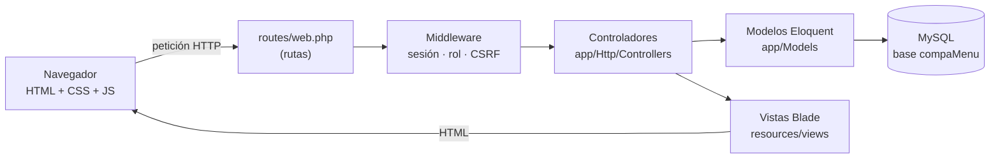
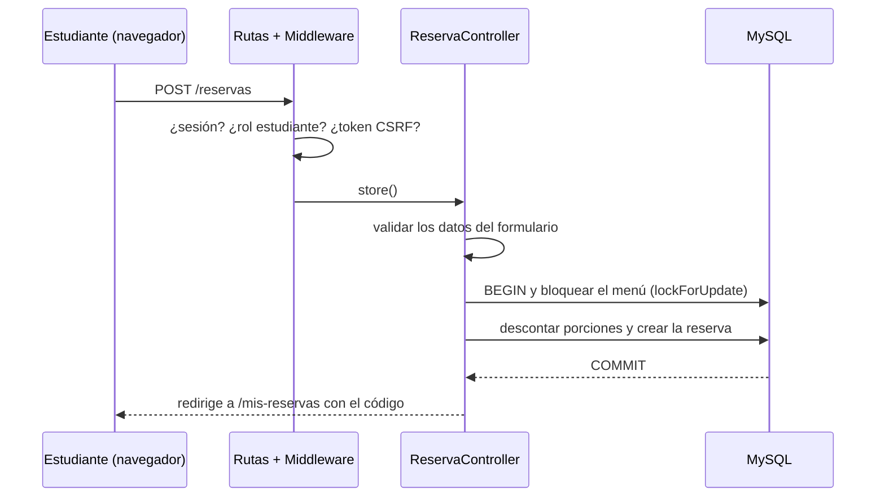
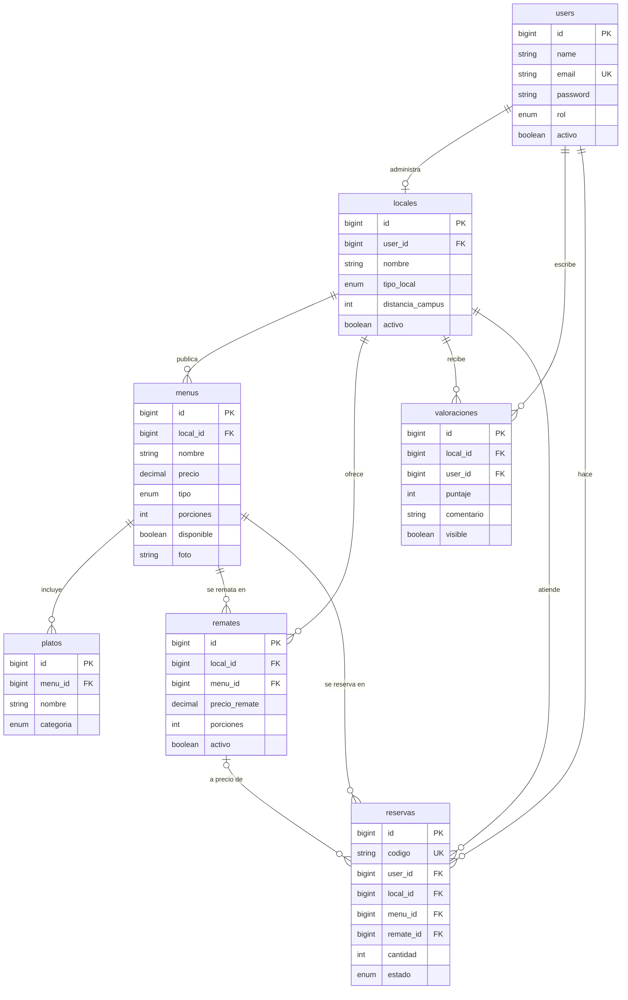
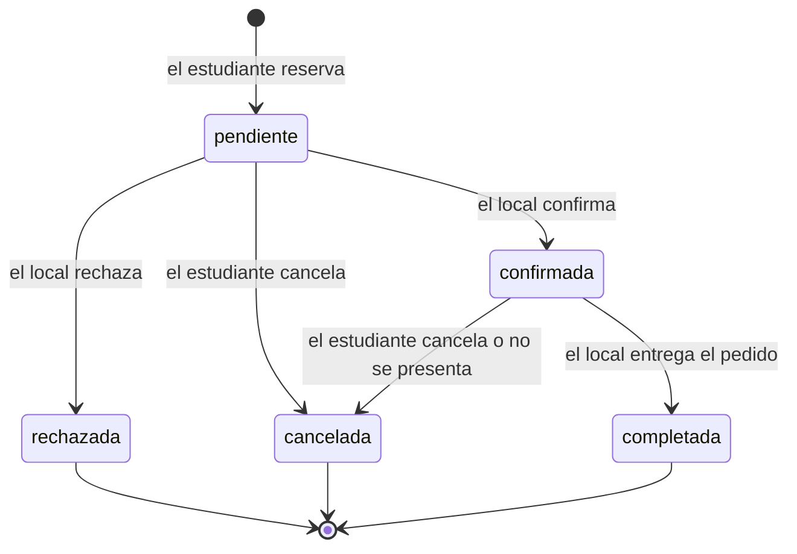
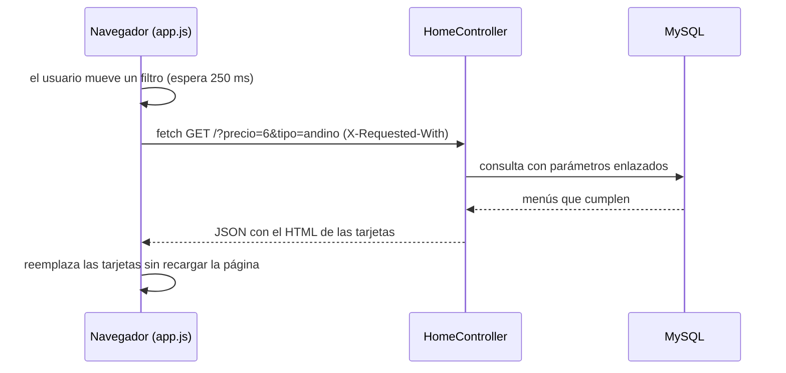

# Arquitectura de CompaMenu

Documento de diseño de la Fase 2 (Diseño y Desarrollo). Describe cómo está organizada la aplicación y por qué.
Los diagramas están escritos en [Mermaid](https://mermaid.js.org/): GitHub los dibuja automáticamente al abrir este archivo.

## 1. Visión general

CompaMenu es una aplicación web **Laravel 13 (PHP 8.4+) con MySQL**. El navegador recibe HTML generado en el servidor (vistas Blade),
con CSS propio sobre Bootstrap 5 y un solo archivo de JavaScript puro para las partes interactivas.



## 2. Patrón MVC y flujo de una petición

| Capa | Qué hace | Dónde está |
|---|---|---|
| **Modelo** | Representa las tablas y sus relaciones; accede a la base con consultas preparadas | `app/Models/` |
| **Vista** | Dibuja la interfaz (HTML con Blade); escapa automáticamente el contenido | `resources/views/` |
| **Controlador** | Recibe la petición, valida, aplica las reglas del negocio y elige la vista | `app/Http/Controllers/` |
| Rutas | Conectan cada URL con un controlador y con el rol que puede usarla | `routes/web.php` |
| Middleware | Filtros previos: sesión iniciada, cuenta activa, rol permitido, token CSRF | `app/Http/Middleware/VerificarRol.php` y los de Laravel |

Ejemplo completo: el estudiante reserva un menú.



## 3. Estructura de carpetas

```
app/
  Http/
    Controllers/          públicos: Home, Menu, Local, Remate, Resena, Reserva
      Auth/               LoginController, RegistroController
      Panel/              establecimiento: Menu, Remate, Reserva, Local
      Admin/              administrador: Resumen, Usuario, Local, Menu, Valoracion, Reserva
    Middleware/           VerificarRol (alias "rol")
    Requests/             MenuRequest (validación del formulario de menús)
  Models/                 User, Local, Menu, Plato, Remate, Valoracion, Reserva
  Providers/              AppServiceProvider (idioma, paginación, datos compartidos)
  Support/                Texto (limpieza de texto y escape de LIKE)
database/
  migrations/             esquema versionado (7 migraciones propias)
  seeders/                datos de ejemplo
resources/views/          layouts · components · partials · páginas · panel · admin · errors
routes/web.php            todas las rutas, agrupadas por rol
public/                   css · js · img · fonts · vendor (Bootstrap) · uploads/menus (fotos subidas)
tests/Feature/            pruebas automáticas
docs/                     esta documentación
```

## 4. Modelo de datos



Reglas de integridad: claves foráneas con eliminación en cascada, un local por usuario (`locales.user_id` único),
una reseña por estudiante y local (único `local_id + user_id`) y código de reserva irrepetible.

## 5. Roles y autorización

La autorización se aplica en **dos niveles**: el middleware `rol:` en las rutas (¿puede este rol entrar aquí?)
y la consulta acotada en los controladores (¿este registro es suyo?).

| Acción | Visitante | Estudiante | Establecimiento | Administrador |
|---|:-:|:-:|:-:|:-:|
| Ver menús, locales, remates y reseñas | Sí | Sí | Sí | Sí |
| Reservar y cancelar sus reservas | — | Sí | — | — |
| Publicar, editar o borrar su reseña | — | Sí | — | — |
| CRUD de menús y remates de su local | — | — | Sí (solo el suyo) | — |
| Confirmar, rechazar o entregar reservas | — | — | Sí (solo las de su local) | — |
| Gestionar usuarios, locales y moderar reseñas | — | — | — | Sí |

## 6. Flujos clave

**Estados de una reserva.** Rechazar o cancelar devuelve las porciones al menú o remate.



**Buscador con Fetch API.** Funciona también sin JavaScript (el formulario se envía por GET).



## 7. Decisiones de diseño

| Decisión | Alternativa descartada | Motivo |
|---|---|---|
| Laravel (MVC) | PHP nativo con MySQLi | La consigna exige framework; Laravel trae validación, sesiones, CSRF y ORM listos y probados |
| Vistas renderizadas en el servidor (Blade) | Aplicación de una sola página (React/Vue) | Menos JavaScript, carga más rápida en celulares básicos y funciona aunque falle el JS |
| Bootstrap 5 + CSS propio | CSS escrito desde cero | Rejilla y formularios responsive ya resueltos; los colores andinos se aplican con variables CSS |
| Fotos en `public/uploads/menus` | Almacenamiento en la nube | Cero configuración en XAMPP; se puede cambiar a otro disco de Laravel sin tocar los controladores |
| Reservas con bloqueo de fila | Descontar stock sin transacción | Evita vender de más cuando dos personas piden la última porción |
| Una tabla `users` con campo `rol` | Tablas separadas por rol | Un solo inicio de sesión y reglas de acceso más simples |

## 8. Accesibilidad, escalabilidad y sostenibilidad

**Accesibilidad (usuarios con distintos niveles tecnológicos).** Interfaz en español y con textos cortos; etiquetas en todos los campos;
`aria-current` y `aria-live`; contraste suficiente; navegación por teclado; diseño responsive; páginas livianas (sin librerías de JavaScript pesadas,
fuente y Bootstrap guardados localmente, fotos reducidas a 640 px); el buscador funciona sin JavaScript.

**Escalabilidad (beneficiar a más personas).** Cada módulo es independiente (modelo + controlador + vistas + migración): el módulo de reservas
se agregó sin modificar locales, menús ni platos. Los listados largos (reseñas, reservas y administración) están paginados, las consultas usan índices y la carga anticipada de relaciones evita consultas repetidas.
Para más tráfico se puede cambiar la sesión y la caché a otro sistema (por ejemplo Redis) y mover las fotos a un disco externo, solo con configuración.

**Sostenibilidad.** Solo software libre; esquema reproducible con `php artisan migrate:fresh --seed`; 25 pruebas automáticas para cambiar el código con seguridad;
documentación en el código y en `docs/`; el costo de operación se reduce a un hosting básico. El Remate Solidario apunta a reducir el desperdicio de comida.

## 9. Seguridad (resumen)

Consultas preparadas (Eloquent), salida escapada (`{{ }}`) y limpieza de HTML al guardar, contraseñas con bcrypt, token CSRF en cada formulario,
sesión regenerada al ingresar, límite de 5 intentos de ingreso por minuto, validación de archivos subidos, control de acceso por rol y por propietario,
y transacciones con bloqueo en las reservas. Detalle por amenaza en el informe, sección 3.6.

## 10. Cómo agregar un módulo nuevo

1. Crear la migración (`php artisan make:migration create_xxx_table`) y el modelo con sus relaciones.
2. Crear el controlador en la carpeta del rol que corresponda (`Panel/`, `Admin/` o público).
3. Validar con un Form Request o `$request->validate()`; limpiar el texto libre con `Texto::limpio()`.
4. Registrar las rutas en `routes/web.php` dentro del grupo del rol (`rol:...`).
5. Crear las vistas Blade con su comentario de cabecera (qué muestra y qué variables recibe).
6. Escribir al menos una prueba en `tests/Feature/` y ejecutar `php artisan test`.
