# Manual de usuario de CompaMenu

Guía corta de uso por perfil. Para instalar y configurar el proyecto, ver el [README](../README.md) y la [guía de configuración rápida](../CONFIGURACION-RAPIDA.md).

## Estudiante

1. **Crear la cuenta** desde *Registro*, eligiendo *Estudiante* (contraseña de al menos 8 caracteres con letras y números).
2. **Buscar** en *Inicio* con los filtros de precio máximo, tipo de plato, distancia o nombre.
3. **Reservar** desde el detalle del menú o del remate: elegir cantidad (1 a 5), hora de recojo y nota, y guardar.
4. **Ver el código y el estado** de la reserva en *Mis reservas*; se puede cancelar y dejar una reseña del local.

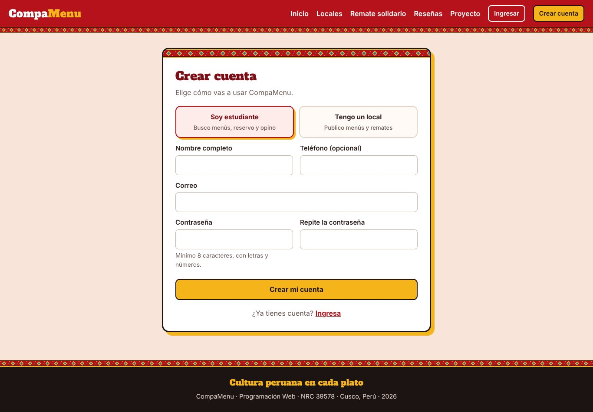
*Registro de estudiante*

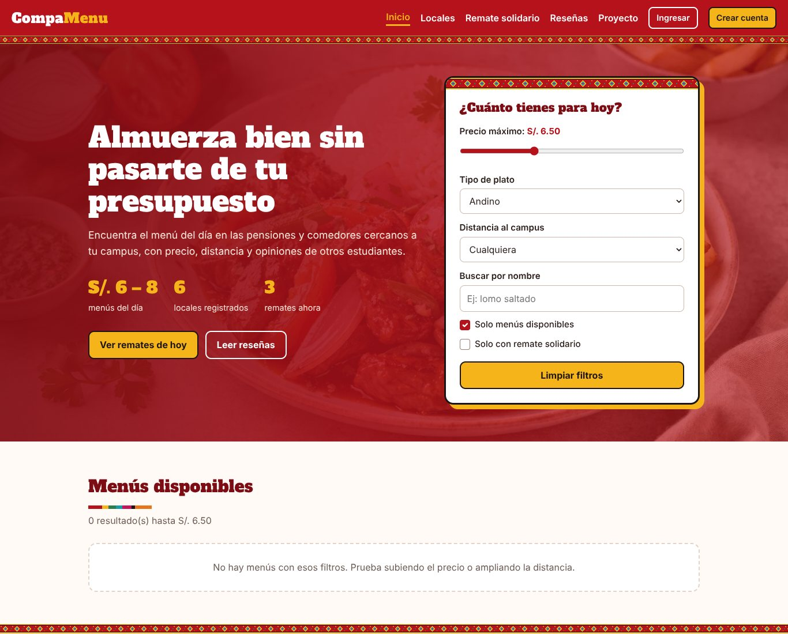
*Búsqueda con filtros*

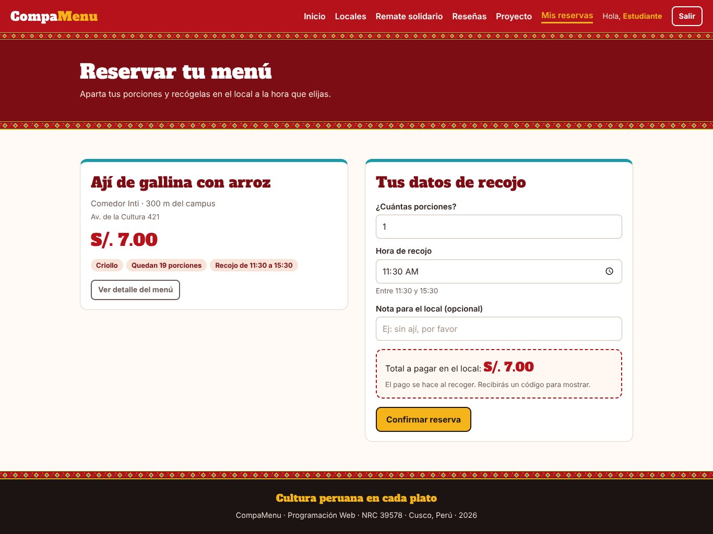
*Formulario de reserva*

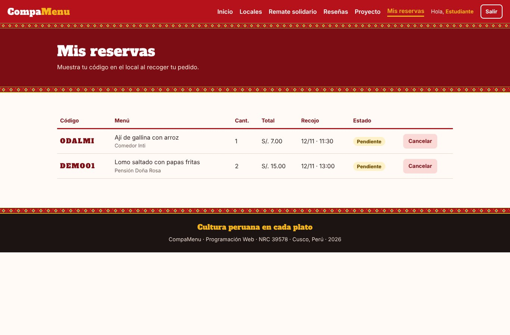
*Mis reservas*

## Dueño de local

1. **Menús:** crear, editar o eliminar menús con sus platos y su foto desde *Mi local*.
2. **Remates:** publicar un menú a precio reducido, con porciones y horario.
3. **Reservas:** confirmar, rechazar o marcar como entregada cada reserva; las pendientes aparecen primero.
4. **Datos del local:** actualizar dirección, horario, teléfono y descripción.

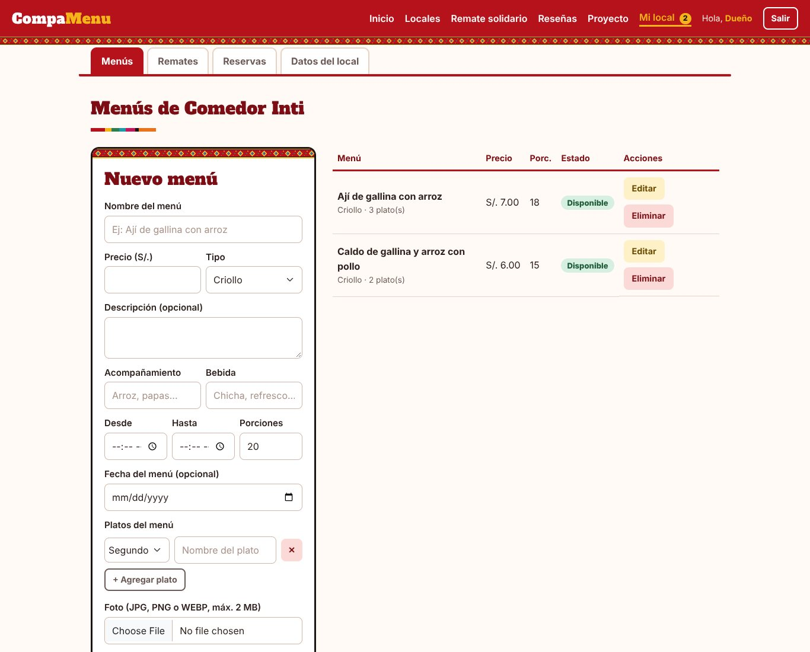
*Mi local: menús*

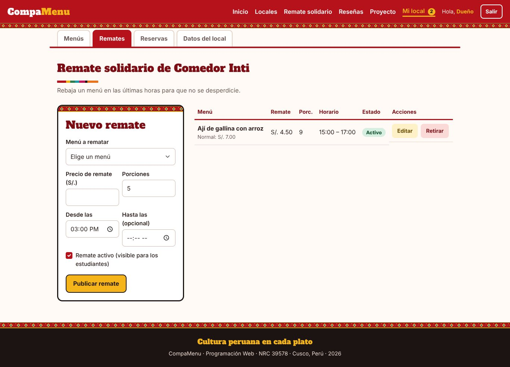
*Mi local: remates*

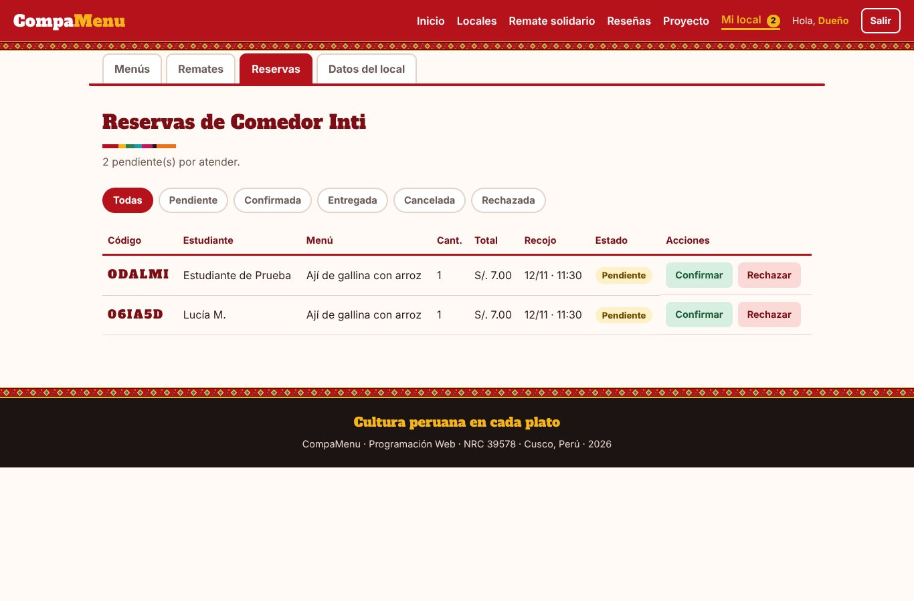
*Mi local: reservas pendientes*

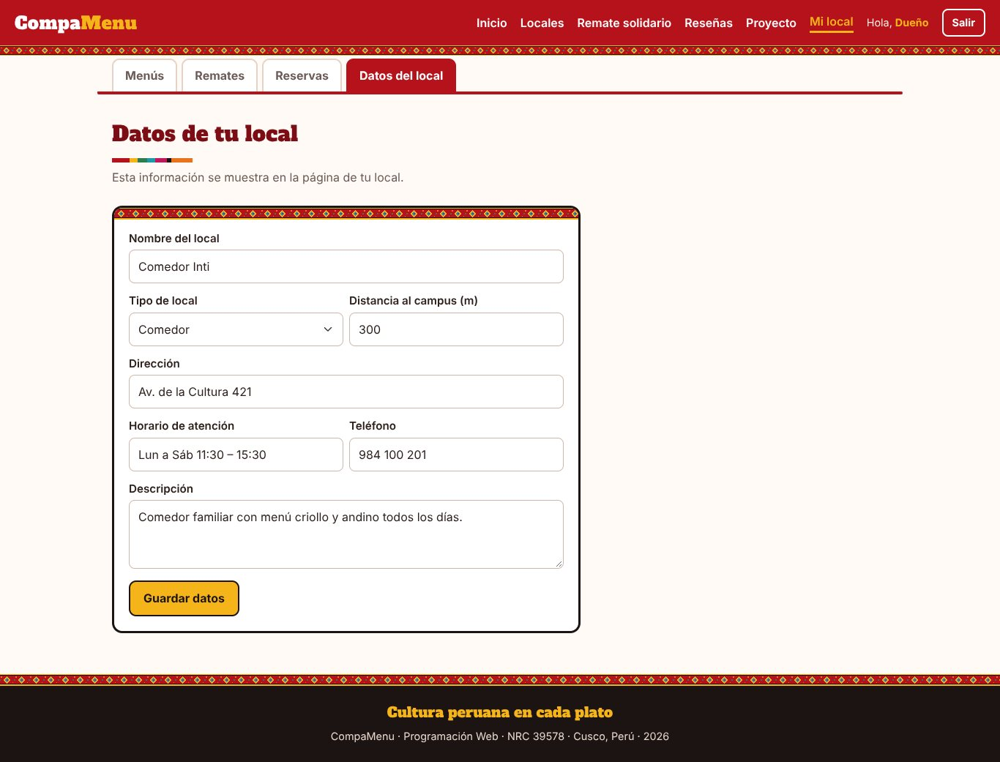
*Mi local: datos del local*

## Administrador

1. **Resumen:** revisar las métricas y los gráficos del sistema.
2. **Usuarios:** activar, desactivar o eliminar cuentas.
3. **Valoraciones:** ocultar o eliminar reseñas que incumplan las normas. También se gestionan locales, menús y reservas.

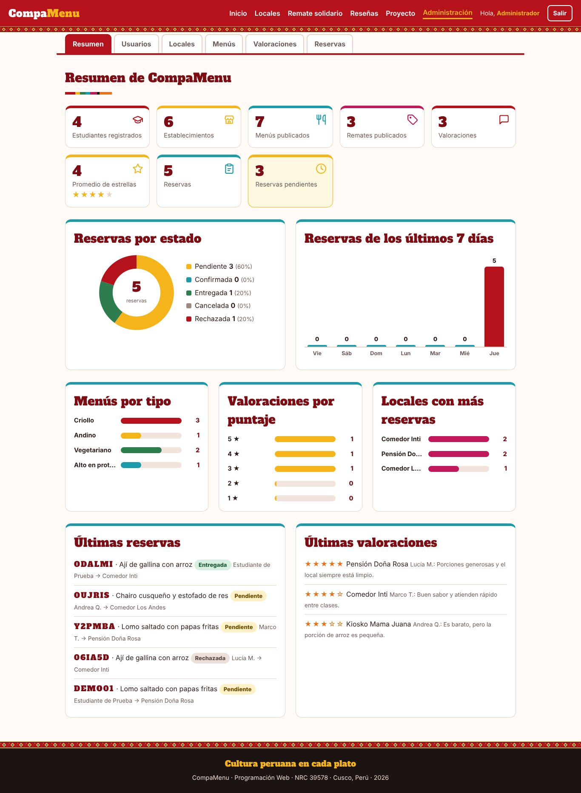
*Administración: resumen*

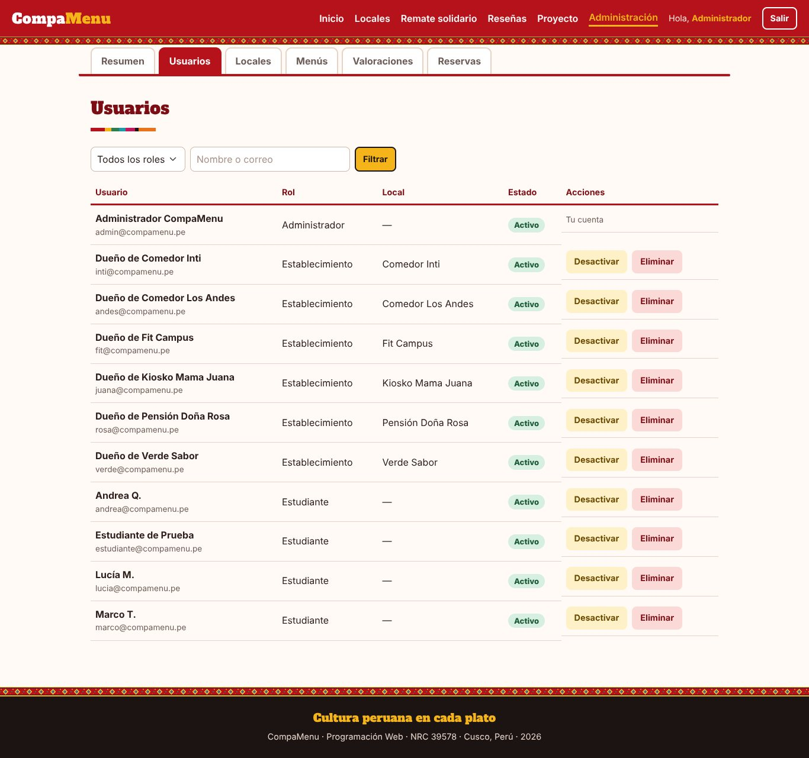
*Administración: usuarios*

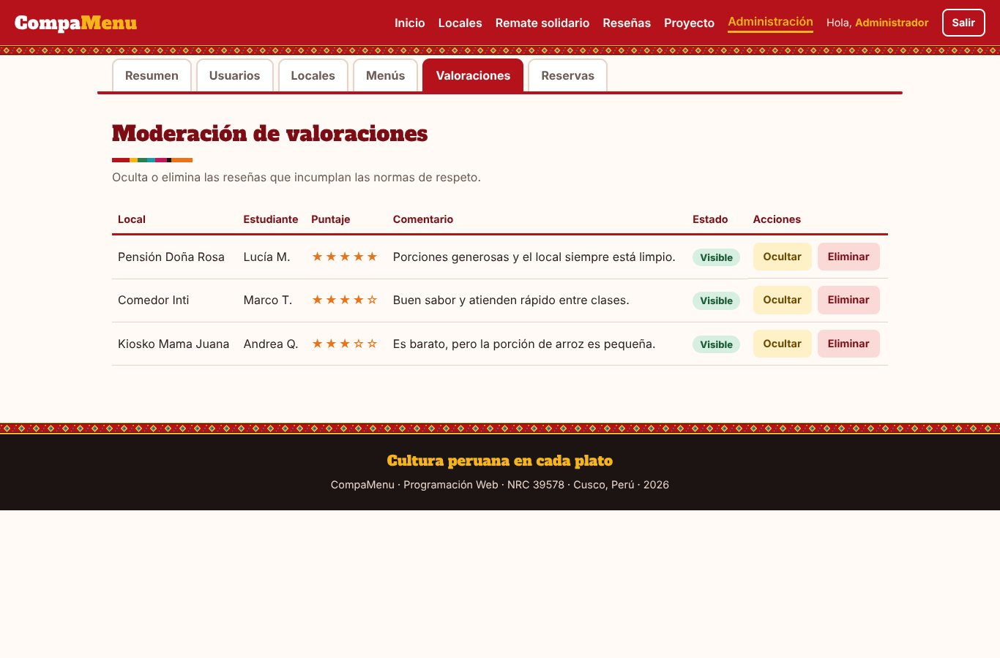
*Administración: valoraciones*
